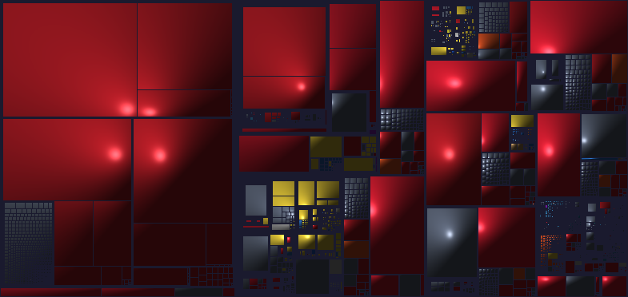

# AtlayaView

Fast local disk space visualization for Windows with cushion treemaps, a WPF desktop UI, and an optional native Rust renderer.

AtlayaView scans one or more drives and turns used storage into an instantly readable treemap, making large folders and files visible at a glance.

> [!IMPORTANT]
> **Trial and license.** AtlayaView can be used **in full for 7 days**. After that you need a license. The license is currently **free of charge**, limited to **3 months**, and you can **renew it as often as you like** for as long as there are no paid licenses. AtlayaView is **closed-source** software and is planned to become a paid product later; the source code is not published.
>
> In the app: **Help → License …** shows your status and device ID, lets you request a license by e-mail, and imports the license file you receive.

> [!NOTE]
> This repository is the **public download and information page** of AtlayaView. It contains no source code (the software is closed-source). Installers are attached to the [Releases](../../releases/latest); problems and wishes can be reported as [Issues](../../issues) or by e-mail.

**Website:** https://atlaya.capecter.com

## Downloads

Downloads are served from the website (they are counted there and always point to the current version):

- Full installer (with .NET): https://atlaya.capecter.com/dl.php?f=atlayaview/2.1.3/AtlayaView-Setup-2.1.3-full.exe
- FX installer (needs the .NET 9 runtime): https://atlaya.capecter.com/dl.php?f=atlayaview/2.1.3/AtlayaView-Setup-2.1.3-fx.exe
- Full portable ZIP: https://atlaya.capecter.com/dl.php?f=atlayaview/2.1.3/AtlayaView-2.1.3-win-x64-full.zip
- FX portable ZIP: https://atlaya.capecter.com/dl.php?f=atlayaview/2.1.3/AtlayaView-2.1.3-win-x64-fx.zip

## Screenshots

## Highlights

- Local-first desktop application for Windows with no cloud dependency; the only network access is the update check and the license check against the official website.
- Native Rust renderer for high-performance treemap drawing, with automatic fallback to the managed C# renderer if the DLL is unavailable.
- Available as a real Windows installer or as a portable ZIP, each in two variants: self-contained and framework-dependent.
- Built-in update check and self-updater for published releases.
- User interface available in German, English, French, Italian, and Spanish.

## License and support

AtlayaView is licensed under the **Atlaya View License v1.0** (see [LICENSE](LICENSE)): closed-source, trial of 7 days, then a device-bound license file.

Support and license requests: **AtlayaView@capecter.com**

Versions up to and including v2.0.36 were published earlier under the MIT License and remain available to their recipients under those terms.
